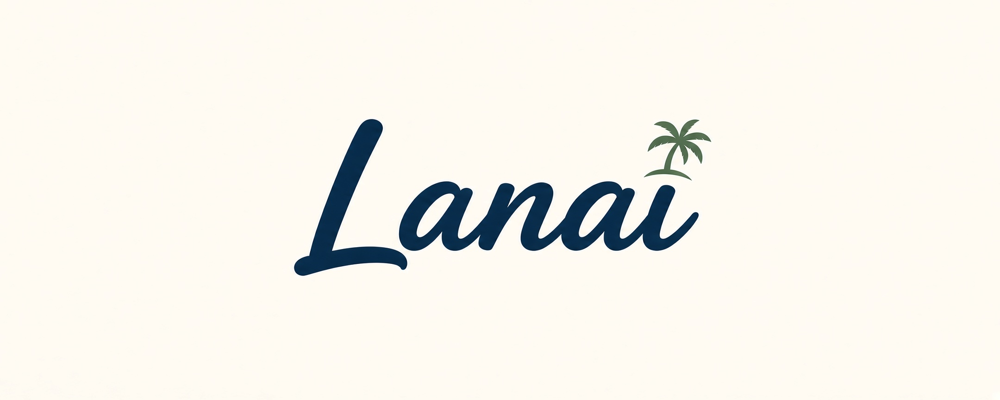

<p align="center"></p>

# Lanai

Run Windows in a window on Omarchy, through [Looking Glass](https://github.com/gnif/LookingGlass).

Status: the spike is done except its measured sessions, and the Lanai plugin is being
built. Phase 7 adds the bar and panel; acceptance and the measured spike sessions
still gate release. The install steps below are for rehearsals on a copy.

## Why

Omarchy's built-in `omarchy-windows-vm` runs Windows in Docker and connects over RDP.
This project tests a different path: a plain QEMU VM that runs as your user, with the
Windows screen shared into Linux through Looking Glass.

Looking Glass's new IDD (Indirect Display Driver) can render in software, so it works
without GPU passthrough. The target users need Windows apps such as Office, or
Windows-only admin tools such as the Active Directory PowerShell modules. Neither needs
a GPU.

## Plan

1. **Spike:** measure Looking Glass software mode against RDP on the same Windows VM.
   See the [spec](docs/spike/spec.md), [plan](docs/spike/plan.md) and
   [results](docs/spike/results.md). The measured sessions have not run yet.
2. **Lanai**, an Omarchy plugin for [plugins.omarchy.org](https://plugins.omarchy.org),
   is being built on the assumption that Looking Glass wins. See its
   [spec](docs/plugin/spec.md). It will not be released until the spike's measured
   sessions pass.

Out of v1: GPU passthrough, and a dedicated partition or NVMe for Windows.

## Lanai

Lanai is an Omarchy bar plugin (id `io.github.jzetterman.lanai`) that runs your
`omarchy-windows-vm` Windows install in plain QEMU, as your user, and shows it in a
Looking Glass window. The plugin sits at the repository root: `manifest.json`, `bin/`,
`lib/`, `systemd/`, `guest/`, `Widget.qml`, `LanaiPanel.qml`, `LanaiModel.qml`
and `test/`. It is under construction; see the
[plan](docs/plugin/plan.md).

## Install and setup

Lanai requires Omarchy's Quickshell plugin API, an existing supported UEFI Windows
install from `omarchy-windows-vm`, `/dev/kvm` access as your user, and enough memory
for Windows and Linux. It does not install Windows or support TPM, Secure Boot or
legacy layouts. Setup installs Arch packages and builds a native client. The plugin
will need manual setup and a maintainer review before it joins the marketplace.

First rehearse on a reflink copy, as described in the [acceptance plan](docs/plugin/plan.md#phase-8-acceptance).
Stop the container VM before setup. For the released plugin, the host commands are:

```sh
omarchy plugin add https://github.com/jzetterman/lanai.git
omarchy plugin enable io.github.jzetterman.lanai --section right
```

Before enabling it for a rehearsal, set `storage` in
`${XDG_CONFIG_HOME:-$HOME/.config}/lanai/settings.json` to the copy's absolute path.
Without that setting Lanai uses `~/.windows`. Memory and cores are optional; setup
seeds them from the container's settings when readable, otherwise from half the
host's memory (at most 16 GiB) and half its CPU threads (at most 8).

Left-click Lanai's L-in-a-monitor glyph to open the panel, then click **Continue setup**.
The panel shows Step N of 6: Check, Packages, Snapshot, Prepare, Drivers and
Verify. Prepare covers storage preparation and building the pinned client.
Drivers covers the Windows install, then Verify checks the result. Completion
returns to the daily header. At the package step, **Install in a terminal** opens
a terminal which shows the exact install command before the normal package-manager
password prompt. Nothing else in Lanai escalates. Dependencies are listed in
[`LANAI_HOST_PACKAGES`](lib/client.sh): QEMU and its GTK/SPICE/device modules,
virtiofsd, passt, socat, jq, Python, diffutils and the Looking Glass build libraries
and tools. Files Lanai downloads itself are pinned with SHA-256 in
[`lib/pins.sh`](lib/pins.sh); the client and IDD use the same build.

Accept the snapshot offer before the first boot, or make a backup and explicitly
continue without a snapshot. A snapshot shares disk blocks, takes little space
initially and grows as Windows changes. After a snapshot, expand Snapshots and
choose **Show details** to see its path and copy it with the icon beside it.
The list updates after each snapshot, delete or restore job, and whenever the
panel refreshes. If the filesystem cannot make a snapshot,
the setup offer explains that you need a backup before continuing without one.
Either **Take a snapshot** button asks for an optional name first: it opens
**Snapshot name (optional)** and becomes **Save snapshot**. Save snapshot, or
Enter in the field, takes the snapshot. A held Enter key does not submit.
**Cancel** or Escape closes the field
and keeps your text for next time; a second Escape closes the panel. From a
terminal, use `lanai snapshot "<name>"`. Leave the name empty for a snapshot
with no name. A name is one line of up to 64
characters, with no `<`, `>`, control or invisible characters. Only ordinary
spaces may separate words.
Lanai trims spaces and line breaks at the ends of a name. If Lanai refuses a
name, the reason shows below the field and your text stays there to fix. If
you closed the panel before the refusal came back, the field opens again with
it. You set a name only when you take the snapshot. The UTC time stays each
snapshot's identity and folder name, so two snapshots can share a name, and Restore and
Delete always use the time. Snapshots show newest first, with readable dates
and times marked UTC. A saved name shows above its date. When two snapshots
share a name in the same minute, their times show seconds. Each row has
**Delete** and **Restore** actions. The count
includes only valid snapshots for this storage location. Restoring asks you to
confirm the snapshot you chose with **Restore now** and warns that later
changes will be lost. Deleting asks you to confirm with **Delete snapshot**
and leaves Windows as it is.
The **Cancel** under the row clears either confirmation. A confirming click
counts only after a short pause, so holding a key cannot arm and confirm in
one press. A deleted snapshot
leaves the list, with no separate message. You can delete a snapshot while
Windows runs or while another VM uses it. Deletion is unavailable while another
operation runs or a restore is unfinished.
Snapshot and restore show their actual phase and measured percentage, also when
you open the panel partway through or start from the CLI. Work with no measured
total shows a busy indicator. A restore names its target above the controls. An
unfinished restore keeps that name when its record is valid; otherwise it shows
a generic restore label. You can close the panel during a snapshot. Keep Windows
stopped until a restore finishes.
Lanai blocks Start while a restore is unfinished. Use **Finish the unfinished
restore** to resume it, or restore another saved snapshot to start over.
When restore work stops unfinished, the panel opens Snapshots to show these actions.
It tries the Lanai data directory's `snapshots/`, then
`<storage>.lanai-snapshots/` on the storage filesystem. Both VMs must be stopped for
snapshot or restore. **Take a snapshot** stays visible but is disabled while Windows
runs, another VM uses the install, a restore is pending, or an operation is busy.
Before a new snapshot, Lanai removes interrupted snapshot
folders whose recorded storage location matches this install, freeing their shared
blocks. Other locations and folders with no recorded location are left alone.
A restore requires running Lanai setup again.
Each operation clones first and reads the image once, then proves its shared
btrfs extents stayed unchanged. Plain, compressed, NOCOW and preallocated
unwritten extents are supported; other filesystems or unprovable extent classes
fall back to backup advice. This detects ordinary writes and interruptions;
deliberate re-cloning or reference juggling by another process running as your
user is outside the proof, including substitution of compressed extent slices.
An existing disk keeps its locked inode during restore. If dockur already deleted
the disk, Lanai publishes its locked clone and verified boot files before reading
it. An unfinished restore can be retried with the same snapshot or replaced
with another saved snapshot. If the snapshot's image is damaged, restore another
snapshot by name. A failed check before the disk is put
in place removes the temporary files. Windows is unchanged only when there was
no earlier unfinished restore.

In the setup window, open Lanai's setup drive in Explorer and run `setup.cmd`. Approve
the administrator prompt as the same Windows user; approval as a different account
is refused. The setup drive must stay **read-only**: do not attach writable setup
media or substitute files written by Windows. Setup shuts Windows down when the guest
install finishes. Let that shutdown finish; Shut down from the panel does not count.
Use Shut down only if setup.cmd stops responding, or when its shared-folder check
tells you to.
setup.cmd checks that the shared folder from Linux appears in Windows as a drive it
can read. It stops if the folder did not appear, if Windows could not read it, or if
the check could not run. When the check could not run and a security tool blocks
scripts, allow Windows PowerShell to run `lanai-share-check.ps1` from the setup
drive. Then restart Windows from the Start menu and run setup.cmd again. If
setup.cmd stopped at this check before, shut Windows down from the Lanai panel
instead, then click **Set up in a basic window** or **Set up in the Windows window**.
Lanai then checks the folder on Linux.
When a setup operation is running, the panel continues setup after Windows shuts
down. Otherwise, click **Continue setup** when the setup script finishes. If Windows
stops during the final checks, click **Continue setup** to start it again.
Verify lists Display driver, Windows agents and Scale task. Each row shows Not
checked, Waiting, Done or Failed from the checks that actually ran. Windows agents
is Done only after the SPICE agent, guest-agent clock and allow-list checks all
pass. Done describes that attempt, rather than continuous health. The scale row
checks that the task opened its port; it does not prove applied scale or a visible
desktop.
The scale task starts when the Windows user who ran setup signs in. Lanai cannot
see the sign-in screen or identify the signed-in user. If Windows asks for a
password, sign in as the user who ran setup. While setup waits for the scale task,
the panel shows the remaining sign-in duration from the backend deadline. The
limit defaults to 2 minutes and follows the setup worker's recorded
`LANAI_SETUP_SCALE_LIMIT` when overridden, even if the panel's environment differs.
Reopening the panel, restarting the shell or restarting Windows does not reset
it. Missing or invalid timing shows no countdown. Continue setup after a stop
starts fresh checks and a fresh scale wait when they pass. If a part does not
answer in time, setup stops and the panel names it. Click **Continue setup** to
check again. To install Lanai's parts in Windows again, shut Windows down, then
click **Set up in a basic window** or **Set up in the Windows window**. Do this too if setup.cmd stopped with a
message in Windows. When the panel says the display driver in Windows needs an update, or the
QEMU guest agent in Windows is missing its allow-list, shut Windows down, then click
**Continue setup** to set up Windows again.
If a setup boot stopped unfinished, the panel shows both **Set up in a basic window**
and **Set up in the Windows window**. Use the basic window until the Lanai display
driver is installed, and the Windows window afterward. **Start Windows** and **Open window**
are hidden only before first-time setup finishes for this location or while a setup
boot or final check boot is running. Lanai starts Windows and opens its window itself
for those boots. A working install keeps those controls when a client or driver
update or an unfinished setup round is pending. Setup shows the pending step beside
them. When the usual controls are hidden and the Windows window closes, use
**Reopen the Windows window** in Setup.
**Snapshots** is hidden while Windows runs during setup and returns when Windows is
off. Settings stay available. The setup card uses
your theme's accent color when it needs you to act and clears the highlight while
Lanai works by itself. Its inset stays the same. During the setup boot, **Shut down**
asks for a second click:
“Shutting down now stops setup. You'll choose how to continue.” A shutdown already
requested for this boot or in progress needs no further confirmation. Arming Shut
down or Force stop clears the other confirmation. Once setup finishes,
the usual controls return. Setup keeps checking while the panel is closed or the shell restarts.
Reopening the panel shows the current step and any running operation. The panel says
setup is finished only when Lanai has recorded its completion for this disk.
A failed or interrupted operation asks you to continue or retry. Click **Continue setup**
to go on. After a shell restart, that button checks where setup stands.
If Windows is running without the setup drive, shut it down before continuing.
During the final checks, wait for any shutdown to finish before continuing setup.
To run setup again after it finishes, shut Windows down, open **More actions**
and click **Run setup again**.
Choose how Windows should show during setup, or click **Cancel** to return.
A restore's success note stays until the next snapshot action; the Setup section
shows whether setup still needs to finish.

## Daily use

Left-click the glyph to open or close the panel in every state. Enter (including
keypad Enter), Space and the Menu key on the focused glyph also toggle the panel.
Right-click starts Windows only when stopped with setup finished and no blocking
operation or unfinished restore. It opens the Windows window when running with
setup finished and the window closed; otherwise it opens the panel. A pending
display driver update opens the panel, where **Start Windows** remains available
for a working install. Closing the Looking Glass window leaves Windows running;
right-click to reopen it. The tooltip names the right-click action and includes
warnings and forced-stop notices. The panel keeps **Start Windows**, **Open window**
and **Shut down** controls. Panel controls support Tab, Shift+Tab, Enter and Space;
Escape closes it.
If starting or opening fails, the glyph opens the panel to explain why. It also
opens the panel when a start reports that the previous run was forced to stop.
The daily header shows saved memory, cores and scale. Draft edits do not change
that line, and it does not describe the running VM's allocation. The divided
**Settings**, **Snapshots** and **Logs** rows open one section at a time.
**More actions** holds Run setup again, updates, notice dismissal and Force stop
when the backend permits them. Failed opens Logs with the cause and recovery
actions. It does not skip the Force stop wait.

Settings accept whole numbers: 1–512 GiB and 1–64 cores. Memory and cores apply
at the next start. Windows scale is “Match my monitor” (the default) or a fixed
percentage: 100–250 in steps of 25, then 300–500 in steps of 50. **Save**
saves the scale only when you chose an entry in the scale list since you opened
the panel or last used Reset, even the entry already shown; otherwise it saves
memory and cores only. **Unsaved** marks changed drafts or a scale selection
since the last successful save. Polls, section changes and failed saves preserve
the drafts. A refused save keeps its result in Settings. **Reset** restores the
current saved values locally and clears scale selection intent. It saves nothing
and does not restore defaults. A clean panel
shows disabled **Saved** and hides Reset and Unsaved.
Typing a changed memory or CPU value makes Save available immediately; clicking
Save commits that text without requiring Enter first.
After a successful scale save, Save and Reset stay available without Unsaved.
Another save still saves scale, even if its value is unchanged. Reset or reopening
the panel clears that intent. Reopening also discards unsaved settings edits.
The CLI equivalent is `bin/lanai settings <GiB> <cores> [auto|percentage]`. Three
arguments always save the scale; two keep the scale choice.

Logs has copy buttons for VM, Window, Build, Jobs and Actions when available.
The VM button copies the user-journal command; file rows copy their full paths.
The shortened display names do not shorten the copied text. Copy runs no log
command. **Copied** confirms success. An inline failure keeps the button available
for retry.

The glyph uses the normal foreground when stopped, an accent and underline while
starting, running or stopping, and a progress underline while busy. Without
measurable progress, a fixed-width segment moves across the underline. A badge
marks your turn or a failure. Failure takes priority, then attention, busy, active
and stopped. The normal Drivers wait for setup.cmd keeps the active glyph while
Windows runs. Recovery and failures keep their priority.

Shut down is available while Windows starts and shuts down. It asks Windows to
shut down cleanly and returns immediately. If Windows ignores the request while
starting, click Shut down again. After 15 seconds from
the first request, the panel offers Force stop, followed by a separate confirming click.
Unsaved work is lost on a forced stop. If the display fails or builds mismatch,
read the panel's cause, next step and named logs. Stop Lanai before using
`omarchy-windows-vm` through RDP or its web console as the fallback.

Outside capture mode (below), Omarchy's Super shortcuts do **not** reach Windows;
use Windows' onscreen menus. Outside capture, Ctrl+Alt+Del is Omarchy's shortcut to
close all windows: it closes the Windows window too, though Windows keeps running.
The shared folder is `~/Windows` on Linux and the virtiofs drive in Windows Explorer.

Capture mode gives the mouse and keyboard to Windows; Omarchy's shortcuts go to
Windows instead. Press Scroll Lock to enter it and Scroll Lock again to leave (many
laptops reach Scroll Lock with Fn and another key);
Looking Glass shows Capture Enabled or Capture Disabled. Scroll Lock with another key
runs one of Looking Glass's own commands, such as Scroll Lock+F for fullscreen. Hold
Scroll Lock to list them.

Over the Windows window, Looking Glass hides your Linux pointer and shows the
Windows cursor in its place. Lanai stops the Looking Glass client from moving your
hidden pointer, so the window's edge follows the mouse when you drag it. That has
two costs:

- Outside capture, after the window changes size without the mouse, such as a
  resize from the keyboard, the Windows cursor can show away from the hidden
  pointer. A click lands at the hidden pointer, so move the
  mouse before you click.
- In capture, the hidden pointer stays at the point in the window where capture
  began. When capture ends, the Windows cursor jumps back to that point. A change of
  window size during capture, such as Scroll Lock+F or a monitor or scale change,
  also moves it there.

Windows' resolution follows the Windows window. When the window opens, resizes,
tiles, goes fullscreen or moves to a monitor with another scale, Windows matches it
within 5 seconds. This also holds after Windows' display driver restarts. Windows
cannot change its desktop size before you sign in. So when Windows starts or
restarts, it matches the window within 15 seconds of your sign-in: when the
Windows user who ran setup signs in, Lanai's scale task sets the size. Its log is
`C:\Program Files\Lanai\lanai-signin.log`. If you sign in as another Windows user,
you may need to resize the window once. To change Windows' resolution, resize the
window. A resolution you pick in Windows' Display settings does not stay: Lanai
sets the window's size again.

Two sizes are exceptions. Lanai never asks for a size under 640 wide or 480 high,
the smallest Windows' display driver takes. Windows also refuses a size too large
for the display memory Lanai gives it, such as fullscreen on a very high-resolution
monitor. Lanai asks a few times, so the screen may flicker or Windows may show a
notice, and then stops. In both cases Windows keeps its last size and the picture
is scaled to fit the window. Resize the window or leave fullscreen to fix it.

Installs set up with an earlier version of Lanai keep working, but Windows may not
match the window, and after the computer wakes from sleep, the mouse may reach
only part of Windows. The panel says what may go wrong and names one step. When
only the Windows window needs an update, Lanai updates it by itself after `omarchy
plugin update`, a shell restart or a sign-in, with no click. The update takes
several minutes, works whether Windows runs or not, and changes nothing in Windows.
You can start and use Windows while it runs, and it gets less CPU than Windows. If
the Windows window was open when the update finished, the panel and the bar's
tooltip say to close it and open it again. If the update fails, or stops twice
before it finishes (for example at a logout), the panel shows the failure and
**Update the Windows window** in More actions, and points to the Windows window
build log or the Jobs log. When
the scale task in Windows was set up without the sign-in step, Windows may stay at
its old size after it starts, until you resize the window. Then the panel names
**Run setup again** instead. It updates the Windows window too, turns the Windows
lock off again, and restarts Windows as setup always does. If setup cannot update
the window, the panel points to the same build log.

Windows' display scale changes while Windows runs, without a restart or sign-out.
“Match my monitor” uses the Windows step nearest the scale of the monitor the
Windows window is on, with ties rounded down. When the window moves to a monitor
with another scale, or that monitor's scale changes, Windows follows within 5
seconds, also while the panel is closed or the shell restarts. While the window is
closed, the monitor it was last on counts; before it first opens, the monitor
focused at start. If that monitor is gone, the focused monitor counts, then the
first one Hyprland lists. Without any monitor the scale stays as it was (100% at
start).

A scale save while Windows runs reaches Windows within 5 seconds if you are signed
in, or within 20 seconds of your next sign-in. Lanai cannot see which, so the panel
says both. A save while Windows is stopped applies at the next start.

You can also pick a scale in Windows, under Settings > System > Display > Scale.
Your pick holds until your next scale save, a sign-out, a Windows restart or the VM
stopping, and the panel notes that saving a scale replaces it. While it holds,
“Match my monitor” does not follow the window. A pick never changes Lanai's
setting. Windows changes its recommended scale when the resolution changes;
the scale task sets it back to your pick, or to the scale you saved in Lanai when
you have no pick. The scale holds as the window resizes: Lanai caps it at
Windows' limit for the current resolution, and it goes back up when the window
grows. The scale task starts more slowly at a sign-in. So the scale changes a
sign-in brings (the scale after a pick ends, and the scale for the size Lanai
sets) finish within 20 seconds of it, not 5.

This is Windows' display scale, separate from its “Text size” setting. While
Windows' custom scaling is on (a percentage that needs a sign-out to apply), it
overrides the scale Lanai sets; turn it off under Settings > System > Display >
Scale, then sign out. Some Windows apps redraw at a new scale only after they
restart. If Windows accepts a change but leaves the scale unchanged, the scale
task tries again once a minute. Its log is
`C:\Program Files\Lanai\lanai-scale.log`.

The scale task runs a small program that setup builds in Windows,
`C:\Program Files\Lanai\lanai-start.exe`. If Windows blocks or removes it later
(for example, antivirus quarantines it, or Smart App Control or an App Control or
AppLocker policy is turned on), the scale and the size at sign-in stop following
Lanai. To fix it, allow the program by its path,
`C:\Program Files\Lanai\lanai-start.exe`, in your antivirus or in the App Control
or AppLocker policy. A rule by file hash stops working, because setup builds the
program again on each run. Or turn Smart App Control off under Windows Security >
App & browser control. Smart App Control allows no single program, and on many
Windows versions only a reinstall turns it back on. Then click **Run setup
again**. Setup checks that Windows runs the program, and stops with these steps
if it does not.

Installs set up before live scale keep the old scale task: a scale save applies at
the next start, the old task undoes scale changes made in Windows, and “Match my
monitor” does not follow the window while Windows runs. The panel's warning says
that scale saves apply only the next time Windows starts, beside the size fix.
The words after a scale save say the same three things. To get live scale, shut
Windows down and click **Run setup again**; it also turns the Windows lock off
again. After you update Lanai while Windows runs, the panel may say some of
Lanai's helpers stopped until Windows next starts. The
[rehearsal checklist](docs/plugin/proofs.md)
covers resizing, scale limits and reconnecting the display.
Host locking, suspend and session shutdown are covered by the
[phase 8 checks](docs/plugin/plan.md#phase-8-acceptance), which remain pending.

## Windows lock and trust exposure

Setup turns locking off for the Windows user who runs it because a locked Windows
ignores Lanai's clean shutdown request. Switch user and the machine inactivity limit
are also off for **every account** on that Windows. Setup replaces any previous lock
settings without saving them. Turning the lock back on uses the three registry
commands in Removal below; they restore Windows' defaults, not your earlier settings.
A domain or MDM policy may turn locking back on. Either that or restoring the lock can
bring back the forced stop, as can a Windows security screen left open, such as UAC.

Dockur already signs Windows in automatically at every boot. RDP and the web console
at `127.0.0.1:8006` still ask for the Windows password (`PROTECT: "Y"`), and any
process running as your Linux user can already read the stored password. Those facts
do not change. Windows now no longer locks itself or on request: an unattended,
unlocked Linux session leaves Windows open for as long as the VM runs. Lock Linux to
cover the Windows window. Lanai never reads or handles the stored Windows password.

Guest setup adds HostFission's signing certificate to the machine's Trusted
Publishers to avoid the Looking Glass driver's publisher prompt. Windows then
accepts **any driver HostFission signs** without asking. Remove that certificate
during removal as described below.

While the Windows window runs, Windows can read **anything copied on Linux,
including files**. Files copied in Windows appear on Linux in a read-only folder
under your runtime directory. This is an accepted guest-to-host exposure alongside
Looking Glass's frames and cursor, SPICE input/audio/clipboard, the network backend,
the confined `~/Windows` share, the QEMU guest agent channel (the clock, plus one
command at setup that its allow-list must refuse) and the
scale channel. The scale channel runs one way: each message holds a scale step and
a save number, and Lanai never reads what Windows writes to it.

Windows opens the scale channel only to administrators, so the scale task runs at
your sign-in with your administrator rights and no prompt. Its program, the
program's source, its script, logs and temp folder sit in `C:\Program Files\Lanai`,
where only administrators can write. Setup builds the program there from Lanai's
source with the C# compiler that comes with Windows, so no prebuilt Lanai program
enters Windows. Such a task still starts with your Windows user's environment
variables and registry settings, so malware already running as that user could use
it to gain administrator rights. With UAC on, that malware has other ways to the
same end.

## Networking and coexistence

DNS uses the host resolver, including search domains and Tailscale MagicDNS. A DNS
client inside Windows, such as Cloudflare WARP or a corporate agent, overrides that.
Windows can reach destinations the host can reach, including VPNs, but cannot reach
services bound only to host loopback. Host services on other addresses remain
reachable. Booting without a host default route starts Windows without networking;
it stays offline until the VM next starts.

The four container-based Windows plugins show **stopped** while Lanai runs plain
QEMU. Lanai uses its own name, L-in-a-monitor glyph and `Lanai,process=lanai` VM name.
A container start then fails safely under the verified dockur behavior. Still,
**do not start `omarchy-windows-vm` while Lanai runs Windows**, and do not change the
container's Windows version, language, disk size or format, `CLEAR`, or custom ISO
mounts while using Lanai. Its known pre-boot write paths are checked at every start;
future dockur changes remain a risk. When container settings are unreadable, Lanai
compares `windows.base` against the normal Windows 11/no-language image and skips
the disk-size check. A container may then grow the disk, adding space without
overwriting Windows data. Unknown layouts are refused.

Verified dockur baseline: **6.05**, captured in `lib/dockur-6.05.args` and the
[proofs](docs/plugin/proofs.md). The exact Omarchy build used for those proof sessions
was not recorded: **phase 8 must record it before release**. Phase 7 targets the
installed shell API from Omarchy **4.0.0.alpha**; this is an API reference, not a
claim of Windows acceptance on that version.

Reboot/power-off shutdown is best effort within Omarchy's approximately 20-second
window; logout allows up to two minutes. **Phase 8 measurement pending: Lanai's clean
Windows shutdown time on John's machine at reboot.** Earlier proof 4 sessions with
idle Windows took 7 seconds at reboot and 11–13 seconds at logout. They do not replace
the final measurement. If the wait expires, the next start reports the forced stop.

## Removal

1. First, shut Lanai's VM down. This Linux command works even without the plugin:

   ```sh
   systemctl --user stop lanai-vm.service
   ```

   It waits for shutdown and can force-stop at the timeout. Let any detached setup,
   snapshot, restore or Windows window update finish before removing its code. Once Lanai's VM
   is stopped, start Windows with `omarchy-windows-vm` and connect over RDP.
   **Do every Windows removal step below in that RDP session**: uninstalling the
   IDD or SPICE vdagent can remove Lanai's display or input, and a normal Lanai boot
   has no QEMU display. Open an administrator Command Prompt as **the same Windows
   user who ran setup** (`HKCU` is account-specific). Restore Windows' default lock
   settings:

   ```bat
   reg delete HKCU\Software\Microsoft\Windows\CurrentVersion\Policies\System /v DisableLockWorkstation /f
   reg delete HKLM\SOFTWARE\Microsoft\Windows\CurrentVersion\Policies\System /v HideFastUserSwitching /f
   reg delete "HKCU\Control Panel\Desktop" /v ScreenSaverIsSecure /f
   ```

   An already absent value needs no deletion. `InactivityTimeoutSecs` is absent by
   default, so nothing is written back. These commands also turn the lock back on
   while keeping Lanai installed. Restart Windows for settings that load at sign-in.

2. Undo the other guest changes before removing the plugin. In Installed apps,
   uninstall the Looking Glass IDD and the QEMU guest agent if no other workflow uses
   them. Removing qemu-ga removes Lanai's clock-only
   `--allow-rpcs=guest-sync,guest-sync-delimited,guest-set-time` service configuration;
   no earlier service configuration was saved. The SPICE vdagent can stay if used by
   the container or another SPICE connection; otherwise uninstall it there too.
   Remove Lanai's scale task and virtiofs service from the administrator prompt:

   ```bat
   schtasks /End /TN "Lanai display scale"
   schtasks /Delete /TN "Lanai display scale" /F
   sc.exe stop VirtioFsSvc
   sc.exe delete VirtioFsSvc
   rmdir /S /Q "C:\Program Files\Lanai"
   ```

   Ending the task ends its program, and the program's end ends the script, so
   `rmdir` can remove them. A task or service already stopped needs no further
   stop. This removes Lanai's `virtiofs.exe`, the scale task's `lanai-start.exe`,
   `lanai-start.cs` and any `lanai-start.old-*.exe`, `lanai-scale.ps1`, the logs
   `lanai-scale.log`, `lanai-signin.log` and `lanai-signin.log.old`, the temp
   folder, and the service's auto-start, dependency and executable-path
   settings. An install set up before live scale also kept the scale log in
   `%LOCALAPPDATA%\Lanai`; delete that folder too. If another workflow depended on a pre-existing
   `VirtioFsSvc`, reinstall/configure its own virtiofs tools before using it;
   setup did not save its previous settings. WinFsp and the newer signed `viofs`
   driver can stay: without that service they do not create Lanai's share, and
   another virtiofs workflow may need them. If unused, uninstall WinFsp in Installed
   apps and uninstall the VirtIO FS device/driver in Device Manager, selecting driver
   removal only after checking that no other device uses it. Container RDP and its
   normal file share do not require Lanai's virtiofs service or scale task.

3. Run `certlm.msc`, open **Trusted Publishers → Certificates**, and remove the
   **HostFission** signing certificate setup added. This removes the permission to
   install any HostFission-signed driver without a publisher prompt. From the
   administrator prompt instead, run `certutil -store TrustedPublisher`, find the
   certificate whose Subject names HostFission, and delete it by its `Cert Hash(sha1)`
   value:

   ```bat
   certutil -delstore TrustedPublisher <Cert Hash(sha1) value>
   ```

4. Shut Windows down from its **Start menu**. Restored locking can drop Lanai's
   shutdown request. The container does not restart automatically
   (`omarchy-windows-vm` uses `restart: "no"`).

5. Remove the plugin on Linux:

   ```sh
   omarchy plugin remove io.github.jzetterman.lanai
   ```

   Reloading, disabling or removing the plugin alone does not stop its VM. With the
   VM and panel operations stopped, optionally remove its persistent VM unit and
   reload the user manager:

   ```sh
   rm -f "${XDG_CONFIG_HOME:-$HOME/.config}/systemd/user/lanai-vm.service"
   systemctl --user daemon-reload
   ```

   Settings, downloaded builds, runtime copies and setup state remain in the Lanai
   directories under XDG config/data/state/cache. Keep snapshots until you know you
   no longer need them. To delete one, remove its folder, at the path Lanai showed
   when it took the snapshot.
   Windows' disk and firmware are kept, and `omarchy-windows-vm` remains available.
   Host packages may stay for other apps; remove only dependencies you know are unused.

## Tests

Run `bats test spike/test`. Tests that need btrfs read `LANAI_TEST_BTRFS_DIR` (for
example `LANAI_TEST_BTRFS_DIR=$PWD/.btrfs-test`, which git ignores) and skip when it is
unset or not on btrfs; CI runs them on a loop-mounted btrfs image. No test boots Windows
or talks to your systemd user manager; QEMU runs only paused (TCG) on 1 MiB scratch
disks for the lock tests. No test downloads or builds the Looking Glass client, runs
sudo, or opens a window: curl, cmake, pacman, sudo, omarchy, systemd-run and hyprctl
are stand-ins. One exception: when `LANAI_TEST_LG_TARBALL` names a local copy of the
pinned source tarball, `test/client-patches.bats` applies Lanai's patches to it,
builds the client, and builds and runs the client's own tests. The guest C# and
PowerShell tests in `test/guest.bats` need `pwsh`. CI does not install it, so CI
skips them: run them locally before a merge. Two QML tests in `test/panel-qml.bats`
load the installed shell's controls from `/usr/share/omarchy/shell`, which CI does not
have, so CI skips them too. Lint with
`shellcheck -x bin/* lib/*.sh spike/lgtest test/*.bats test/helpers.bash spike/test/*.bats
docs/plugin/proof-kit/proof-vm docs/plugin/proof-kit/proof-unit-start
docs/plugin/proof-kit/proof-unit-stop docs/plugin/proof-kit/clock-ping
docs/plugin/proof-kit/size-window-on-open docs/plugin/proof-kit/stamp-client-log
test/fixtures/fake-qmp test/fixtures/fake-qga test/qml-lint`.

Run `test/qml-lint`.

Panel fixtures in `test/panel.bats`,
`test/panel-jobs.bats` and `test/ui.bats` use a fake CLI and host facts without
sockets or a VM. `test/panel-qml.bats` runs the real renderer in Qt 6 with inert
shell and Process types when Qt 6’s test runner is available. It never starts the
Omarchy shell. Its ten-board integration generates real backend replies with
`test/panel-fixtures.bash`, shared with the backend panel tests. It covers
recovery, partial checks, invalid timing, read failures and the bar matrix too.
The [redesign acceptance notes](docs/plugin/redesign/plan.md#acceptance-notes)
record automated results and pending theme and VM checks. `lanai panel` supplies
the complete view, including settings,
snapshot names and plain-language results; the QML polls every two seconds only
while its own panel is open, and every fifteen seconds otherwise.
With Windows running or stopped, the daily view shows no status lines or
disabled-action hints: the status badge and the Open window or Start Windows
button carry the routine status, and Open window's extra guidance is in its
tooltip. A running restore is quiet too: its target, progress and warning say
what runs. Successful
snapshot details and a path copy button are available in Snapshots through **Show details**, while failures
remain visible above the controls. Direct actions are recorded by `lanai ui-run`; setup, snapshots,
restores and updates run in session units through `lanai ui-job`, with
diagnostics in Lanai’s state directory as
`panel-run.log` and `panel-job.log`. The panel labels these as the Actions log
and the Jobs log. Rapid repeated clicks keep the first
launch pending. Other controls preserve a failed launch notice until the next
setup, snapshot, restore or update starts. The Windows window log has its own
path, and so does the Windows window build log, `build-client.log` in Lanai’s
state directory; the Windows VM log is in your user journal, under lanai-vm.

Lanai is MIT licensed (see [LICENSE](LICENSE)), except the patches to the
Looking Glass client in `patches/looking-glass/`. Those carry Looking Glass's
license, GPL-2.0-or-later, and its full text is in
[COPYING](patches/looking-glass/COPYING) beside them.
